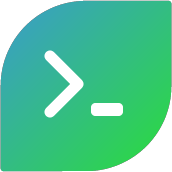
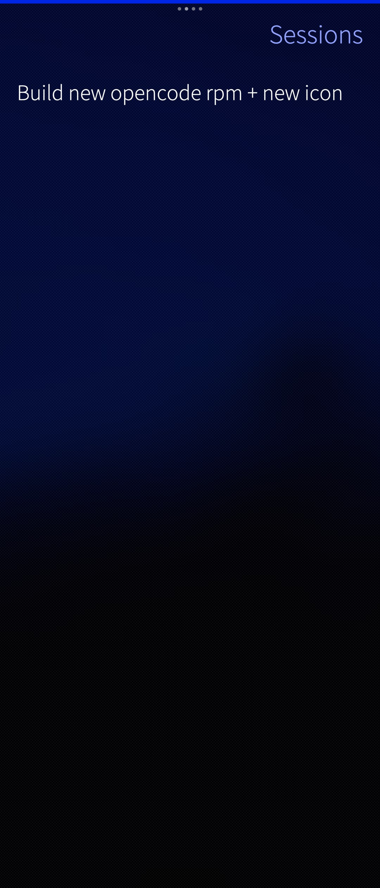
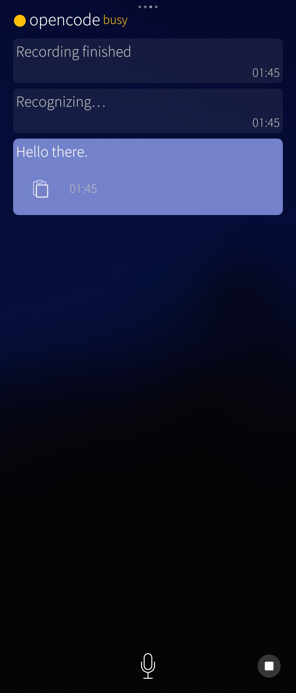
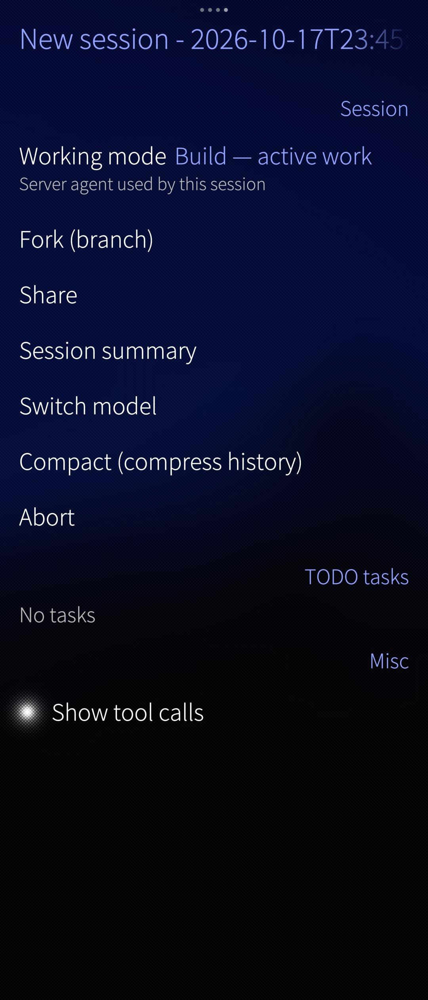
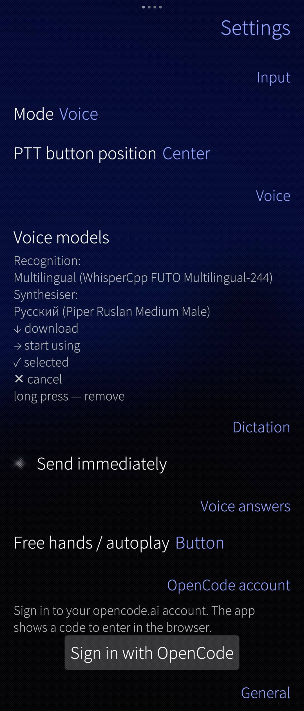

  

<h1 align="center">opencode для Sailfish OS</h1>

<strong>Ваш умный помощник, который всегда в кармане.</strong>

**opencode** превращает ваш телефон на Sailfish OS в помощника для работы, учёбы и повседневных дел. Просто напишите или скажите, что нужно — и приложение поможет.

## Что можно делать прямо на телефоне

- **Диктовать заметки голосом.** Надиктуйте мысль, идею или список дел — приложение превратит речь в текст.
- **Планировать день и проекты.** Составляйте планы, списки задач и расписания в удобном диалоге.
- **Разбираться в больших документах.** Откройте длинный текст — получите краткое содержание, главные мысли и ответы на вопросы.
- **Прослушать сводку голосом.** Попросите озвучить краткий пересказ документа или ответа, чтобы не читать с экрана.
- **Сформировать PDF из текста.** Превратите заметки, черновики или итоги разговора в аккуратный PDF-документ.
- **Подключаться к своим компьютерам.** Работайте с другими устройствами удалённо: проверяйте файлы, запускайте команды и продолжайте дела с того места, где остановились.
- **Разрабатывать и править приложения.** Обсуждайте код, находите ошибки, получайте подсказки и вносите изменения — даже когда рядом нет ноутбука.
- **Управлять удалёнными серверами.** Подключайтесь к серверам и выполняйте привычные задачи администрирования через диалог.
- **Работать с почтой и другими инструментами.** С помощью консольных программ можно читать и писать письма, искать информацию и автоматизировать рутинные действия.
- **Быстро получать ответы и идеи.** Попросите объяснить тему, переписать текст, подготовить черновик сообщения или придумать варианты решения.

## Почему это удобно

- Всё в одном месте — чат, голос и работа с задачами.
- Подходит и для быстрых дел, и для серьёзной работы.
- Помогает экономить время: меньше ручной рутины, больше готовых результатов.
- Работает на вашем телефоне Sailfish OS — помощник всегда под рукой.

## Скриншоты

<table>
  <tr>
    <td align="center"></td>
    <td align="center"></td>
  </tr>
  <tr>
    <td align="center"></td>
    <td align="center"></td>
  </tr>
</table>

## Совместимость

Пока приложение распространяется как **harbour-opencode** для устройств **aarch64** на **Sailfish OS 5.1**.

## Для разработчиков

Техническое описание, архитектура, сборка и деплой перенесены в [DEVELOPMENT.md](DEVELOPMENT.md).

## Лицензия

MIT. См. [LICENSE](LICENSE) и [AUTHORS.md](AUTHORS.md).

> Независимый клиент, не аффилирован с Jolla Ltd. и проектом opencode. `opencode` — отдельный продукт его авторов (см. [opencode.ai](https://opencode.ai)).
