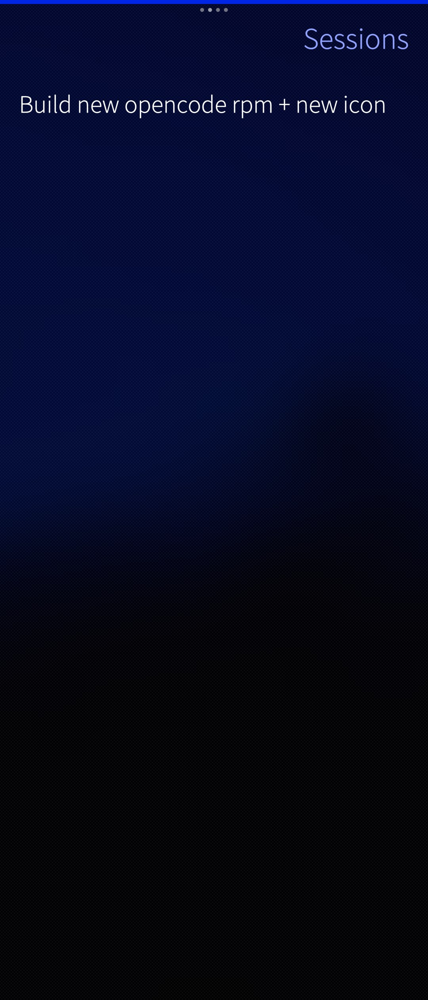
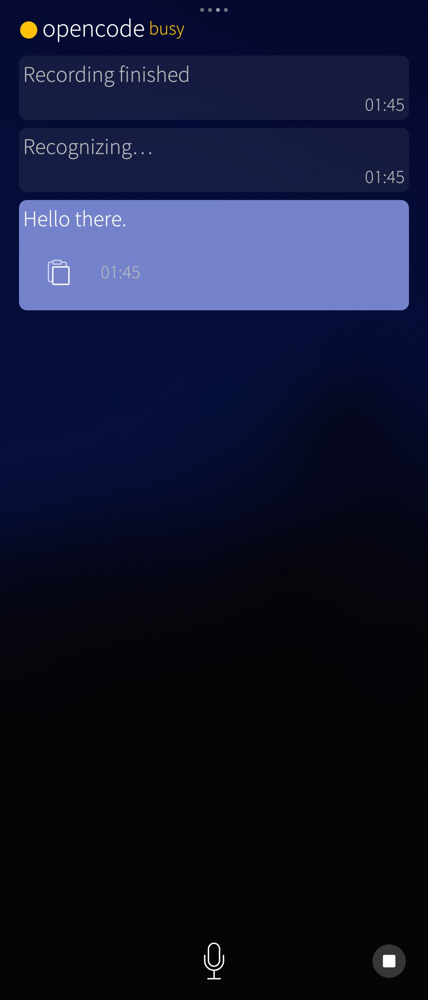
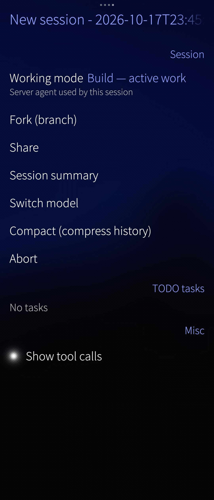
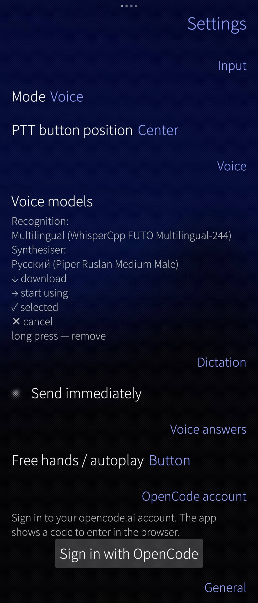

  

<h1 align="center">opencode for Sailfish OS</h1>

<strong>Your smart assistant, always in your pocket.</strong>

**opencode** turns your Sailfish OS phone into a helpful assistant for work, study, and everyday tasks. Just type or speak — and get things done.

## What you can do right on your phone

- **Dictate notes by voice.** Capture an idea, a thought, or a to-do list — the app turns your speech into text.
- **Plan your day and projects.** Create plans, task lists, and schedules in a simple chat.
- **Understand large documents.** Open long text and get a clear summary, key points, and answers to your questions.
- **Listen to summaries out loud.** Ask the app to read a short summary of a document or response so you don’t have to read from the screen.
- **Create PDF documents from text.** Turn notes, drafts, or conversation results into a neat PDF document.
- **Connect to your other computers.** Work with your devices remotely: check files, run commands, and continue where you left off.
- **Build and improve apps.** Discuss code, find issues, get suggestions, and make changes — even without a laptop nearby.
- **Manage remote servers.** Connect to your servers and handle everyday admin tasks through the chat.
- **Work with email and other tools.** Use console tools to read and write emails, search for information, and automate routine work.
- **Get quick answers and ideas.** Ask for explanations, rewrites, message drafts, or different ways to solve a problem.
- **Choose from supported AI providers.** Use the providers available through opencode, including Claude (Anthropic), and pick the model that fits your task.

## Why it’s convenient

- Everything in one place — chat, voice, and task workflows.
- Great for quick tasks and serious work alike.
- Saves time: less routine, more ready-to-use results.
- Built for Sailfish OS — your assistant is always at hand.

## Screenshots

<table>
  <tr>
    <td align="center"></td>
    <td align="center"></td>
  </tr>
  <tr>
    <td align="center"></td>
    <td align="center"></td>
  </tr>
</table>

## Compatibility

Currently distributed as **harbour-opencode** for **aarch64** devices running **Sailfish OS 5.1**.

## For developers

Technical details, architecture, build, and deployment instructions are in [DEVELOPMENT.md](DEVELOPMENT.md).

## License

MIT. See [LICENSE](LICENSE) and [AUTHORS.md](AUTHORS.md).

> Independent client, not affiliated with Jolla Ltd. or the opencode project. `opencode` is a separate product by its authors (see [opencode.ai](https://opencode.ai)).
